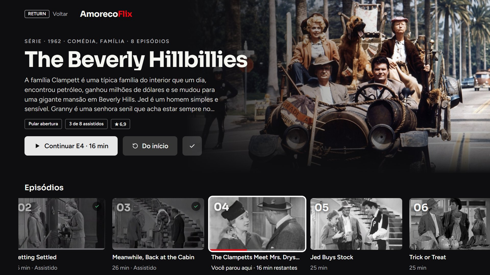
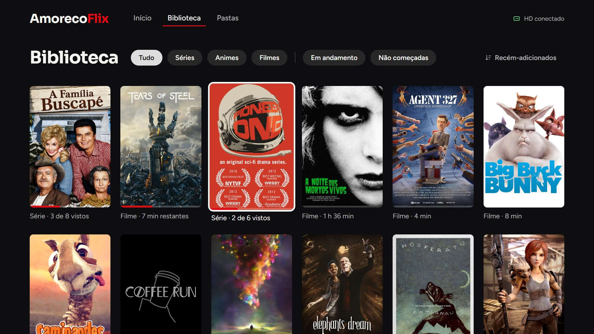
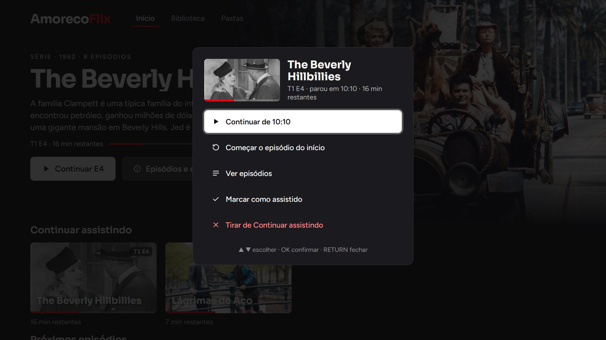
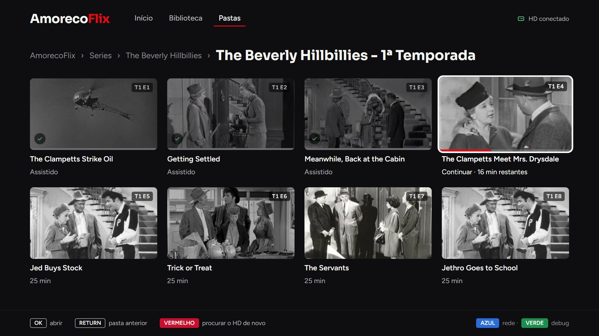
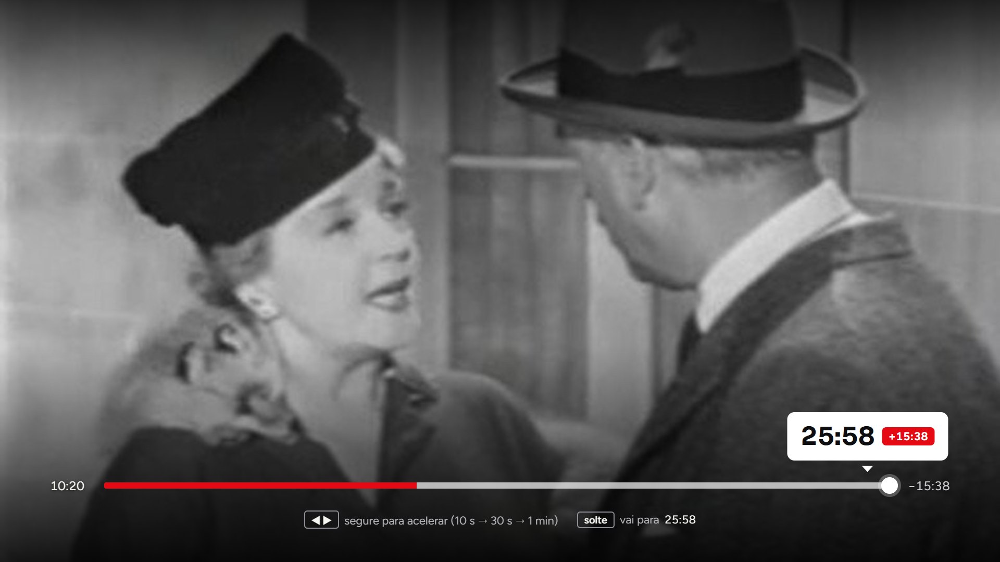
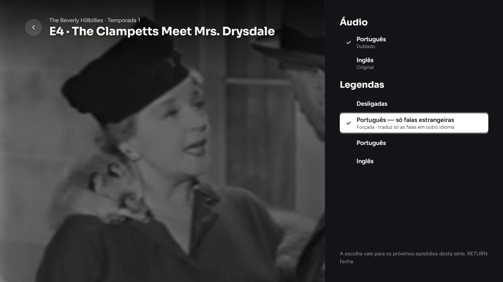
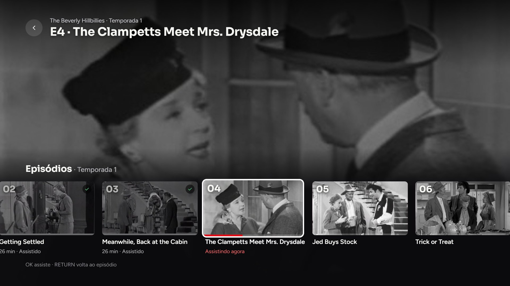

# AmorecoFlix

Um "Netflix pessoal" para Smart TV Samsung (Tizen): um app que toca os vídeos de
um **HD USB ligado direto na TV**, com capas, sinopses, "Continuar assistindo",
próximo episódio, pular abertura e escolha de áudio e legenda. Sem servidor, sem
nuvem e sem assinatura: a TV lê o HD e o progresso fica salvo no próprio HD.

O repositório traz também os **scripts do PC** (PowerShell) que organizam a
biblioteca: importar episódios, baixar capas e sinopses do TMDB, organizar
legendas, detectar créditos e checar se o arquivo vai tocar na TV.

> Feito e testado numa **Samsung UN50DU7700 (Tizen 9)**, instalado por sideload
> (modo desenvolvedor). Deve funcionar em outras Samsung com Tizen recente, mas
> não foi testado.
>
> O projeto não inclui nem baixa vídeos: ele só toca o que já está no seu HD.


## Telas

| | |
|---|---|
|  **Página da série**: temporadas, episódios com título e progresso |  **Biblioteca**: pôsteres com filtros |
|  **Opções**: segurar OK num card |  **Pastas**: o HD do jeito que está organizado |
|  **Player**: barra, ±10 s, episódios, áudio e legendas |  **Avanço**: segurar ◀ ▶ acelera, com balão |
|  **Áudio e legendas**: a escolha vale para a série |  **Episódios**: troca sem sair do vídeo |

<sub>Capturas do [simulador](#simulador-testar-sem-a-tv) com uma biblioteca de demonstração:
Pioneer One (Creative Commons), A Família Buscapé (episódios em domínio público),
curtas abertos da Blender Foundation, Nosferatu (1922) e A Noite dos Mortos-Vivos
(1968). Imagens e textos do TMDB.</sub>

## O que o app faz

- **Início**: destaque com o que você está vendo, **Continuar assistindo** e
  **Próximos episódios**.
- **Página do título** (série, anime, filme ou coleção): sinopse, nota, ano,
  seletor de temporada, episódios com título e progresso, e marcar a temporada
  como vista.
- **Biblioteca**: grade de pôsteres com filtros (séries, animes, filmes, em
  andamento, não começadas, recém-adicionados) e o selo "NOVO EP".
- **Pastas**: navegação pelas pastas do HD, para quando você quer ver tudo.
- **Opções** (segurar OK num card): continuar, começar do início, marcar como
  assistido, tirar de "Continuar assistindo".
- **Player** (AVPlay da TV):
  - avanço acelerado com balão ao segurar ◀ ▶;
  - "Pular abertura" e card de "Próximo episódio" nos créditos;
  - painéis de **Episódios** e **Áudio e legendas** (a escolha vale para a série toda);
  - legendas embutidas ou externas (`.srt`, `.ass`, `.vtt`...).
- **Retomada confiável**: volta ao ponto salvo mesmo nos casos em que o AVPlay
  dessa TV trava no seek (detalhes em [Como funciona](#como-funciona)).
- **Progresso no HD** (`progresso.json` + backup): sobrevive a reinstalar o app
  e a trocar o HD de porta.
- **Histórico de assistidos** (`assistidos.json`): o que você já viu fica
  salvo mesmo depois de apagar o arquivo; baixou de novo (outro nome, outra
  qualidade), volta marcado como assistido.
- Ignora sozinho os vídeos de propaganda que vêm junto dos torrents.

## Estrutura do HD

O app procura uma pasta `AmorecoFlix` na raiz do HD:

```
AmorecoFlix/
├── Series/
│   └── The Vampire Diaries/
│       ├── The Vampire Diaries - 1ª Temporada/
│       │   ├── The Vampire Diaries S01E01.mp4
│       │   └── ...
│       └── The Vampire Diaries - 2ª Temporada/
├── Animes/
│   └── Death Parade/                 (episódios soltos também valem)
├── Filmes/
│   ├── Tenet (2020) [1080p].mkv      (filme solto)
│   └── Vingadores/                   (pasta = coleção)
├── thumbs/      capas e miniaturas      (scripts do PC)
├── subs/        legendas externas       (organizar-subs.ps1)
├── meta/        biblioteca.json, fundos/, posters/   (metadados.ps1)
├── skip.json    abertura, encerramento e créditos    (skip-anime.ps1, detectar-creditos.ps1)
├── progresso.json   gravado pelo app
└── assistidos.json  histórico de assistidos (gravado pelo app)
```

As pastas de temporada são reconhecidas como `Nome - 2ª Temporada`,
`Temporada 2`, `Season 2` ou `S02`, e os episódios por `S01E02`, `1x02`,
`Episódio 2` ou `02 Título`. Sem as pastas `thumbs`, `meta`, `subs` e o `skip.json`
o app funciona do mesmo jeito, só com menos informação na tela.

## Requisitos

- TV Samsung com Tizen e **modo desenvolvedor** ligado.
- PC com Windows e:
  - [Tizen Studio](https://developer.samsung.com/smarttv/develop/getting-started/setting-up-sdk/installing-tv-sdk.html)
    com as TV Extensions e o Samsung Certificate Extension;
  - JDK 17;
  - [ffmpeg](https://ffmpeg.org/) (opcional: miniaturas, créditos, checagem de arquivos);
  - Node.js (opcional: simulador).
- Uma [chave do TMDB](https://www.themoviedb.org/settings/api) para capas e sinopses.

## Instalação na TV

1. **Modo desenvolvedor**: na TV, abra **Apps**, digite `12345` no controle,
   ligue o **Modo de Desenvolvedor**, informe o IP do PC e reinicie a TV.
2. **Conectar**: com PC e TV na mesma rede:
   ```powershell
   sdb connect IP_DA_TV
   ```
3. **Certificado Samsung** (obrigatório para TV de loja): no Certificate Manager
   do Tizen Studio, crie um perfil **Samsung** (login na conta Samsung). Com a
   TV conectada, o assistente lê o DUID dela para o certificado de distribuidor.
4. **Build e instalação**:
   ```powershell
   .\build.ps1 -Profile NOME_DO_PERFIL -Install -Tv IP_DA_TV
   ```
   O `build.ps1` monta o pacote numa pasta temporária só com os arquivos do app
   (nunca com `.env`, `.git` ou scripts) e para se o `index.html` ou o
   `style.css` citarem um arquivo que ficou de fora.

> **Pegadinha**: a TV recusa instalar se o `<name>` do `config.xml` tiver
> espaços (`Failed to install Tizen application`, sem log).

## Scripts do PC

Copie `.env.example` para `.env` e preencha a chave do TMDB. O `.env` fica fora do
git e do pacote da TV.

| Script | Para que serve |
|--------|----------------|
| `Importador.bat` / `importador.ps1` | Janela para passar episódios e filmes de Downloads para o HD: análise, cópia verificada, legendas, miniaturas, metadados e revisão opcional por IA (Gemini ou Claude). Filmes de uma franquia vão para a pasta da coleção (a que já existe, ou uma nova quando vêm 2 ou mais juntos). |
| `import-serie.ps1` | O mesmo fluxo, por linha de comando. |
| `metadados.ps1` | Sinopse, ano, gêneros, nota, títulos dos episódios e artes do TMDB em `meta/`. Incremental; `-Only "Série"` refaz um título, `-Force` refaz tudo; correções manuais em `meta/ids.json`. |
| `checar-compatibilidade.ps1` | Arquivo corrompido, truncado ou com codec de risco para a TV (ffprobe/ffmpeg). |
| `skip-anime.ps1` | Abertura e encerramento de animes (API do AniSkip) no `skip.json`. |
| `detectar-creditos.ps1` | Início dos créditos (ffmpeg) no `skip.json`: o card de próximo episódio aparece ali. |
| `gerar-thumbnails.ps1`, `capas-temporada.ps1`, `posters-*.ps1` | Miniaturas e capas em `thumbs/`. |
| `organizar-subs.ps1` | Junta as legendas em `subs/`. |
| `limpar-lixo.ps1` | Remove arquivos de release e propaganda (só simula; `-Apply` apaga). |
| `transferir-hd.ps1` | Cópia de pastas grandes com Robocopy. |
| `calendario-lancamentos.ps1` + `calendario.html` | Calendário de episódios novos das suas séries. |
| `lib.ps1` | Funções comuns (`.env`, ffmpeg, buscas no TMDB). |

Os scripts funcionam no Windows PowerShell 5.1.

## Envio de arquivos pela rede (opcional)

O app tenta se conectar sozinho a um PC na rede local (WebSocket, porta 8788)
para receber arquivos grandes e gravá-los no HD sem tirá-lo da TV. O IP do PC
vem de `AmorecoFlix/netupload.json`:

```json
{ "pcIp": "192.168.0.10", "port": 8788 }
```

Sem esse arquivo, ele tenta um IP padrão e, sem resposta, fica quieto.

## Simulador (testar sem a TV)

```powershell
node tools/simulador/serve.js
```

Abra `http://localhost:8765/test.html`. O simulador roda o app de verdade no
navegador, com uma TV falsa (HD em memória e um AVPlay simulado, inclusive os
travamentos de seek vistos na TV real). Com `?hd=real` ele lê a sua biblioteca
(variável `HD`, padrão `E:/AmorecoFlix`) **sem gravar nada**. Parâmetros e
atalhos em [`tools/simulador/LEIA.txt`](tools/simulador/LEIA.txt).

## Teclas do controle

| Tecla | Telas | Player |
|-------|-------|--------|
| Direcionais | mover o foco (para cima no topo = abas) | ◀ ▶ voltam/avançam (segurar acelera); ▼ botões; ▲ voltar |
| OK | abrir; **segurar = Opções** | play/pause; pula a abertura / assiste o próximo quando o botão aparece |
| PLAY / PAUSE | - | play/pause |
| ⏩ / ⏪ | - | +85 s / -85 s |
| RETURN | tela anterior / pasta anterior | fecha o painel; senão sai do vídeo |
| VERMELHO | procurar o HD de novo | - |
| VERDE | console de debug na tela | console de debug na tela |
| AMARELO | - | áudio e legendas |
| AZUL | status da rede / cancelar envio | - |

## Como funciona

**Código do app** (o que vai para dentro do `.wgt`):

| Arquivo | Papel |
|---------|-------|
| `config.xml` | Manifesto Tizen e privilégios. |
| `index.html`, `style.css`, `fonts/` | Telas, design (tokens em `:root`) e fontes Sora/Figtree embutidas. |
| `app.js` | HD (`tizen.filesystem`), `Player` (AVPlay, retomada, travamentos), `ProgressStore`, capas, legendas, skip, próximo episódio, envio pela rede. |
| `js/nav.js`, `js/router.js` | Foco por D-pad em grupos declarados por tela; pilha de telas e camadas. |
| `js/library.js` | Títulos, temporadas e episódios lidos das pastas + `meta/biblioteca.json`. |
| `js/components.js` | Ícones, cards, imagens com carregamento preguiçoso, rolagem por `transform`. |
| `js/player-ui.js`, `js/screens/*.js` | Interface do player e das telas. |

**Retomada.** Nessa TV, pedir `seekTo()` e chamar `play()` sem esperar o seek
terminar deixa o AVPlay em "PLAYING" parado no quadro do ponto salvo, e todo
seek seguinte falha (`PLAYER_ERROR_SEEK_FAILED`). Por isso cada tentativa usa
um player recém-aberto e um de dois métodos: **seek antes do play** (play só
quando o seek termina) ou **play antes do seek**. O método que funcionar fica
memorizado. Só conta como retomado quando o vídeo **anda** depois de chegar no
ponto. Se tudo falhar, a tela "Retomando" pergunta: começar do início ou tentar
de novo (o ponto continua salvo). Travamento no meio do vídeo segue a mesma
lógica, reabrindo o arquivo um pouco à frente em vez de recomeçar.

**Progresso.** A cada ~3 s vai para o `localStorage`; no HD
(`progresso.json` + `progresso.bak.json`), no máximo a cada 30 s e sempre ao
pausar, parar ou sair. A chave é o caminho relativo à biblioteca, então não
importa com que nome a TV monta o HD. Ao abrir, os dois são mesclados episódio
a episódio (fica o mais recente). Passou de 92% do vídeo, conta como assistido.

**Assistidos.** O `progresso.json` é por caminho; o `assistidos.json` (+ `.bak`)
guarda o "já vi" por equivalência: série + TxEy (numeração do
`biblioteca.json` ou do nome), nome do filme + ano e o id do TMDB. Nunca é
limpo quando o arquivo some, só ao desmarcar. Ao ler a biblioteca, arquivo sem
progresso cujo equivalente já foi visto volta como assistido.

**Debug.** A TV de loja não deixa ler logs nem abrir o Web Inspector pelo
`sdb`. Por isso o app mostra o console na tela (tecla VERDE) e grava em
`AmorecoFlix/amorecoflix.log`, para ler no PC.

O redesign das telas foi planejado em [`PLANO-REDESIGN.md`](PLANO-REDESIGN.md).

## Créditos

- Metadados e imagens: [TMDB](https://www.themoviedb.org/). *Este produto usa a
  API do TMDB, mas não é endossado nem certificado pelo TMDB.*
- Aberturas e encerramentos de animes: [AniSkip](https://aniskip.com/).
- Fontes [Sora](https://fonts.google.com/specimen/Sora) e
  [Figtree](https://fonts.google.com/specimen/Figtree) (SIL Open Font License,
  textos em `fonts/`).
- Projeto pessoal, sem relação com a Samsung nem com a Netflix.

## Licença

[MIT](LICENSE). As fontes em `fonts/` seguem a licença OFL delas.
